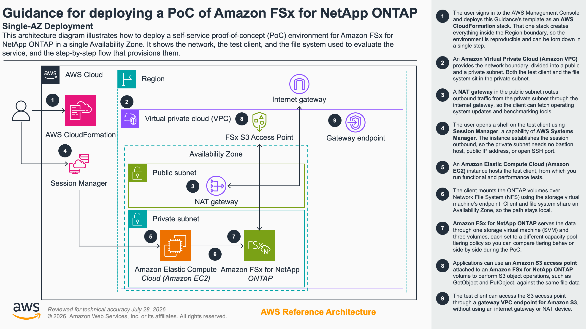
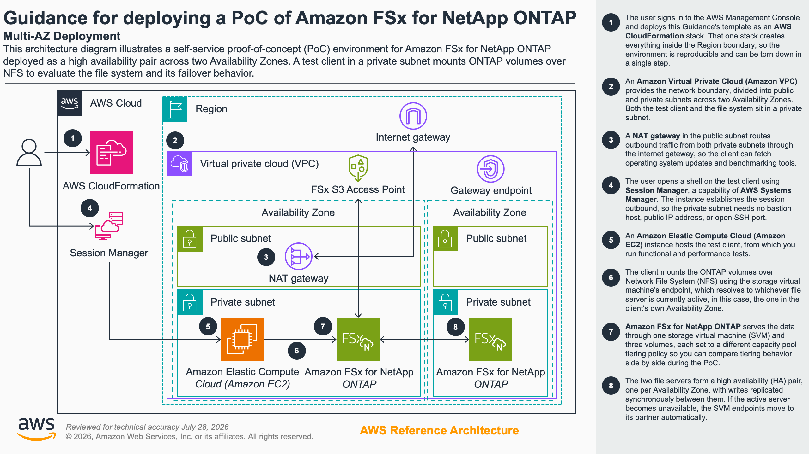

# Guidance for deploying a PoC of Amazon FSx for NetApp ONTAP

## Table of Contents

1. [Overview](#overview)
    - [Cost](#cost)
2. [Methodology for conducting a PoC](#methodology-for-conducting-a-poc)
3. [Example of a PoC key success criteria matrix](#example-of-a-poc-key-success-criteria-matrix)
4. [FSx for NetApp ONTAP configuration guidance](#fsx-for-netapp-ontap-configuration-guidance)
5. [Prerequisites](#prerequisites)
    - [Operating System](#operating-system)
6. [Deployment Steps](#deployment-steps)
7. [Deployment Validation](#deployment-validation)
8. [Running the Guidance](#running-the-guidance)
9. [Next Steps](#next-steps)
10. [Cleanup](#cleanup)
11. [Notices](#notices)
12. [Authors](#authors)

<br/><br/>

## Overview

**Proof-of-Concept (PoC)** deployments that don't accurately reflect your workload requirements or lack clear success criteria can lead to suboptimal outcomes and extended evaluation times. This guide provides a **self-service PoC framework** for [Amazon FSx for NetApp ONTAP](https://aws.amazon.com/fsx/netapp-ontap/), including AWS CloudFormation templates and configuration guidance. With this guide, you can perform either functional testing or full performance testing of FSx for NetApp ONTAP. The goal is to help you set up and configure FSx for NetApp ONTAP quickly and effectively during PoC tests. Using this guide and the provided CloudFormation templates, you can quickly deploy, configure, and test an FSx for NetApp ONTAP file system. This enables you to assess its suitability for your workload in terms of performance, scalability, integration, and functionality. When deploying the CloudFormation templates you can select between two options:

* A **high-performance** FSx for NetApp ONTAP file system to evaluate its suitability for your workload across performance, scale, integration and functional testing.
* A **functional** FSx for NetApp ONTAP file system optimized for cost rather than performance to determine suitability for functional testing at a lower price point.

You can test the deployed FSx for NetApp ONTAP file system with your own applications/tools, or with the example tools we have provided.

Amazon FSx for NetApp ONTAP is a fully managed service that provides highly reliable, scalable, high-performing, and feature-rich file storage built on the popular NetApp ONTAP file system. FSx for NetApp ONTAP combines the familiar features, performance, capabilities, and API operations of NetApp file systems with the agility, scalability, and simplicity of a fully managed AWS service. It supports multi-protocol access (NFS, SMB, iSCSI), automatic data tiering between SSD and capacity pool storage, instant snapshots, writable FlexClone volumes, SnapMirror replication, and inline data compression and deduplication.

This diagram illustrates the Guidance's architecture, how it's deployed, key components and their interactions, with a step-by-step flow.



The diagram above highlights the following:
1. The user logs into the AWS Management Console and deploys the Proof-of-Concept (PoC) template provided in this Guidance, using AWS CloudFormation to create a new stack.
2. AWS CloudFormation deploys an Amazon VPC with public and private subnets, an Internet Gateway, and a NAT Gateway.
3. AWS CloudFormation deploys an Amazon EC2 compute instance in the private subnet. This instance is used to conduct performance, functional, and integration testing with the deployed FSx for NetApp ONTAP file system.
4. AWS CloudFormation configures the Amazon EC2 instance with AWS Systems Manager, allowing Session Manager to be used for secure CLI access to the instance without a bastion host.
5. AWS CloudFormation deploys an Amazon FSx for NetApp ONTAP file system with one Storage Virtual Machine (SVM) and three volumes configured with different tiering policies (AUTO, SNAPSHOT_ONLY, NONE).
6. The EC2 instance UserData automatically installs NFS utilities and mounts all three FSxN volumes at `/mnt/fsxn/vol1`, `/mnt/fsxn/vol2`, and `/mnt/fsxn/vol3`.

**Single-AZ Deployment**

The Single-AZ template deploys all resources in a single Availability Zone. This is the most cost-effective option for PoC testing.


**Multi-AZ Deployment**

The Multi-AZ template deploys the FSxN file system across two Availability Zones with automatic failover.



<br/><br/>

### Cost

You are responsible for the cost of the AWS services used while running this Guidance. As of August 2026, the cost for running this Guidance with the default **Functional** settings in the US East (N. Virginia) Region is approximately **$468 per month** (1,024 GiB SSD storage, 384 MBps throughput capacity, one t3.medium EC2 instance, and one NAT Gateway). The total cost is based on your deployment values for the following AWS resources:

- **Amazon EC2** — This Guidance deploys a single EC2 instance. For a **Functional** deployment, a t3.medium instance is deployed providing ~5 Gbps of burst network bandwidth along with 2 vCPU and 4 GiB RAM. For a **Performance** deployment, a c6in.8xlarge instance is deployed providing 50 Gbps of dedicated network throughput along with 32 vCPU and 64 GiB RAM. Post-deployment, you can change the EC2 instance type as required.
- **Amazon FSx for NetApp ONTAP** — This Guidance uses **second-generation** file systems (`SINGLE_AZ_2` / `MULTI_AZ_2`) which provide uniform performance specs across all AWS Regions and higher burst capability. Second-generation Single-AZ file systems also support NVMe/TCP and an NVMe read cache; note these require the **6,144 MBps** throughput tier and are not available at the default 384 MBps Functional tier.
- **Amazon FSx for NetApp ONTAP** — Costs include SSD storage capacity (provisioned), capacity pool storage (consumed), and throughput capacity. [Refer to Amazon FSx for NetApp ONTAP pricing details](https://aws.amazon.com/fsx/netapp-ontap/pricing/).
- **Network components** — NAT Gateway, Elastic IP, and data transfer charges.

*We recommend creating a [Budget](https://docs.aws.amazon.com/cost-management/latest/userguide/budgets-managing-costs.html) through [AWS Cost Explorer](https://aws.amazon.com/aws-cost-management/aws-cost-explorer/) to help manage costs. Prices are subject to change. For full details, refer to the pricing webpage for each AWS service used in this Guidance.*

#### Sample Cost Table

The cost to run this Guidance is based on the **configuration of your FSx for NetApp ONTAP** file system and the **EC2 instance** that you select.

As an example, if you deploy this Guidance with the default **Functional** deployment type using a **t3.medium** EC2 instance and a **1,024 GiB** SSD, **384 MBps** throughput capacity second-generation FSx for NetApp ONTAP Single-AZ file system in the **US East (N. Virginia) (us-east-1)** region, the approximate cost is shown below (pricing verified June 2026). Refer to the [FSx for NetApp ONTAP pricing page](https://aws.amazon.com/fsx/netapp-ontap/pricing/) for current pricing in your region.

**Functional Deployment Type:**

| AWS Service | Dimensions | Example Sizing | Hourly Cost (USD) | Daily Cost (USD) |
|---|---|---|---|---|
| Amazon FSx for NetApp ONTAP — SSD | $0.125 per GB-month | 1,024 GiB | $0.18 | $4.27 |
| Amazon FSx for NetApp ONTAP — Throughput | $0.72 per MBps-month | 384 MBps | $0.38 | $9.22 |
| Amazon FSx for NetApp ONTAP — Capacity Pool | $0.0219 per GB-month | 0 GiB (initial) | $0.00 | $0.00 |
| Amazon EC2 | $0.0416 per hour for t3.medium | Single t3.medium | $0.04 | $1.00 |
| NAT Gateway | $0.045 per hour + data | 1 NAT Gateway | $0.05 | $1.08 |
| **Total** | | | **$0.65** | **$15.57** |

**Performance Deployment Type:**

| AWS Service | Dimensions | Example Sizing | Hourly Cost (USD) | Daily Cost (USD) |
|---|---|---|---|---|
| Amazon FSx for NetApp ONTAP — SSD | $0.125 per GB-month | 2,048 GiB | $0.36 | $8.53 |
| Amazon FSx for NetApp ONTAP — Throughput | $0.72 per MBps-month | 3,072 MBps | $3.07 | $73.73 |
| Amazon FSx for NetApp ONTAP — Capacity Pool | $0.0219 per GB-month | 0 GiB (initial) | $0.00 | $0.00 |
| Amazon EC2 | $1.814 per hour for c6in.8xlarge | Single c6in.8xlarge | $1.81 | $43.54 |
| NAT Gateway | $0.045 per hour + data | 1 NAT Gateway | $0.05 | $1.08 |
| **Total** | | | **$5.29** | **$126.88** |

**Note:** Capacity pool storage is billed based on consumed capacity. Initially no data is tiered, so the cost is $0. As data is tiered from SSD to the capacity pool, you will incur capacity pool charges at $0.0219 per GB-month. The cost savings from tiering can be significant — capacity pool storage is approximately 80% less expensive than SSD storage.

<br/><br/>

## Methodology for conducting a PoC

- Define your workload requirements and the desired PoC outcomes.
- Create a key success criteria matrix for your PoC that includes output items such as:
  - Performance (such as IOPS, throughput, latency, application-specific metrics)
  - Integration, data access, monitoring, and any specific application requirements

  **Note**: When looking to measure performance, it's important to understand factors such as the read-to-write ratio and IO profile of your workload, file size distribution, the number of clients that will concurrently access the FSx for NetApp ONTAP file system, and the Amazon EC2 instance type capabilities (CPU/memory/network) that you will use to host your application.

- Identify and obtain the tools/applications that you will use to perform your testing.
- Characterize and create any required datasets that will be used for testing.
- Identify and obtain the required AWS privileges for deployment of your PoC components in AWS. Refer to [Prerequisites](#prerequisites) for further information.
- Deploy your PoC environment when you have the above items completed.
- Tune the FSx for NetApp ONTAP file system configuration based on your data profile and workload requirements.
- Evaluate the elements defined in your PoC key success criteria matrix through testing in the PoC environment.
- Test again as required by tuning your application, FSx for NetApp ONTAP configuration (throughput capacity, tiering policies, NFS mount options), or EC2 instance type.
- Tear down your PoC environment as required.

<br/><br/>

## Example of a PoC key success criteria matrix

Below is an example PoC key success criteria table that you can populate when you run your different PoC configuration and test scenarios. Prior to conducting a PoC, it's important to take note of your **workload configuration**. Below are some of the suggested items to obtain values for. As you navigate through this document you will obtain guidance to help you update the Amazon FSx for NetApp ONTAP configuration section.

### Scenario 1:

#### Workload Configuration

| Item | PoC Value |
|------|-----------|
| Amazon EC2 compute instance type to be used by workload | |
| Network throughput capability of Amazon EC2 instance selected | |
| Number of concurrent compute nodes, or threads used for testing | |
| Workload dataset size | |
| Average file size or size distribution | |
| Data read/write access ratio | |
| Data sequential/random access ratio | |

<br/><br/>

#### Amazon FSx for NetApp ONTAP Configuration

| Item | PoC Value |
|------|-----------|
| Deployment type (Single-AZ or Multi-AZ) | |
| SSD storage capacity provisioned (GiB) | |
| Throughput capacity provisioned (MBps) | |
| Capacity pool storage consumed (GiB) | |
| Number of SVMs | |
| Number of Volumes | |
| Tiering policy configured (none / snapshot-only / auto / all) | |
| Protocols enabled (NFS / SMB / iSCSI) | |
| ONTAP snapshot policy and retention | |
| Amazon FSx automatic backup retention (1-90 days) | |
| AWS Backup plan and copy destinations (optional) | |
| NetApp SnapMirror RPO and destination deployment type (optional) | |
| SnapLock requirement and retention mode (optional) | |

<br/><br/>

#### Performance Testing

| Metric | Target Value | PoC Value |
|--------|-------------|-----------|
| Latency (ms) | | |
| Throughput (MB/s) | | |
| IOPS | | |
| Application-specific performance metric(s) | | |

<br/><br/>

#### Functional Testing

| Feature | Outcome |
|---------|---------|
| NFS mount and read/write | |
| SMB map and read/write | |
| iSCSI connect and read/write | |
| Cross-protocol data access (write via NFS, read via SMB) | |
| S3 access point read/write | |
| ONTAP snapshot create and restore | |
| Amazon FSx or AWS Backup create and restore (optional) | |
| FlexClone create and validate | |
| Data tiering to capacity pool | |
| NetApp SnapMirror replication and DR failover (optional) | |

<br/><br/>

## FSx for NetApp ONTAP configuration guidance

Amazon FSx for NetApp ONTAP provides a fully managed NetApp ONTAP file system in the AWS Cloud. This section provides guidance on key configuration decisions for your PoC deployment.

#### Deployment Types

You can choose between two FSx for NetApp ONTAP deployment types:

- **Single-AZ (SINGLE_AZ_2)** — Second-generation Single-AZ file system. Deploys an HA pair of file servers in separate fault domains within a single Availability Zone. Data is replicated within the AZ and infrastructure fails over automatically (typically within 60 seconds). Provides the lowest cost and lowest latency, with high availability and durability within an AZ (but not cross-AZ resiliency). Supports up to 12 HA pairs for scale-out (this PoC uses 1 HA pair). Suitable for development, testing, and workloads that do not require cross-AZ redundancy.

- **Multi-AZ (MULTI_AZ_2)** — Second-generation Multi-AZ file system. Deploys a preferred and standby file server in two different Availability Zones with synchronous cross-AZ replication. Provides automatic failover (typically under 60 seconds) during planned maintenance or unplanned disruptions, including the loss of an entire AZ. Supports 1 HA pair. Recommended for production workloads requiring the highest availability. Covered by the [Amazon FSx SLA](https://aws.amazon.com/fsx/sla/) Multi-AZ commitment of **99.99%** monthly uptime.

**Trade-offs:**

| Aspect | Single-AZ | Multi-AZ |
|--------|-----------|----------|
| Resiliency | Within a single AZ | Across two AZs (survives AZ loss) |
| Availability SLA | 99.9% (Single-AZ SLA; no protection against AZ loss) | 99.99% (Multi-AZ SLA) |
| Failover | Automatic within AZ (<60s) | Automatic cross-AZ (<60s) |
| Write latency | Lower | Slightly higher (synchronous cross-AZ replication) |
| Write throughput | Up to 1,024 MB/s per HA pair | Up to 2,048 MB/s per HA pair |
| Cost | Lower | Higher (~2x infrastructure) |
| Use case | Dev/test, non-critical workloads | Production, mission-critical workloads |

For PoC testing, a **Single-AZ** deployment is typically sufficient and more cost-effective. Use the Multi-AZ template if you need to evaluate failover behavior or cross-AZ availability.

#### SSD Storage Capacity

The primary SSD storage tier provides consistent, low-latency performance for your active data.

- **Minimum capacity**: 1,024 GiB
- **Maximum capacity**: 1 PiB (1,048,576 GiB) per file system
- SSD storage capacity can be increased or decreased after deployment
- The default PoC template provisions 1,024 GiB, which is sufficient for most PoC testing scenarios

SSD storage capacity determines the amount of high-performance storage available for your active dataset. Data that is infrequently accessed can be automatically tiered to the lower-cost capacity pool tier based on the volume's tiering policy.

#### Throughput Capacity

Throughput capacity determines the sustained speed at which the file server can serve data, and also determines the amount of in-memory caching on the file server.

Available throughput tiers for second-generation Single-AZ file systems (per HA pair, all regions):

| Throughput (MBps) | Network baseline (MBps) | Network burst (MBps) | In-memory cache (GB) | Disk baseline (MBps) | Disk burst (MBps) | SSD baseline IOPS | SSD burst IOPS |
|---|---|---|---|---|---|---|---|
| 384 | 781 | 6,250 | 16 | 384 | 3,125 | 12,500 | 65,000 |
| 768 | 1,563 | 6,250 | 32 | 768 | 3,125 | 25,000 | 65,000 |
| 1,536 | 3,125 | 6,250 | 64 | 1,536 | 3,125 | 50,000 | 65,000 |
| 3,072 | 6,250 | — | 128 | 3,072 | — | 100,000 | — |
| 6,144 | 12,500 | — | 256 | 6,144 | — | 200,000 | — |

**Notes:**
- These specs are **uniform across all AWS Regions** — no distinction between enhanced and standard specs.
- File systems at 384, 768, and 1,536 MBps can burst to significantly higher levels for short periods (up to 6,250 MBps network, 3,125 MBps disk, 65,000 IOPS).
- The 384 and 768 MBps tiers only support one HA pair. To add HA pairs, the file system must be configured with at least 1,536 MBps.
- NVMe read cache (1,900 GB) is available at the 6,144 MBps tier.
- See the [FSx for ONTAP performance documentation](https://docs.aws.amazon.com/fsx/latest/ONTAPGuide/performance.html) for complete specifications.

**Guidance:**
- Select a throughput tier that matches or exceeds your workload's peak throughput and IOPS requirements.
- Higher throughput tiers also provide more in-memory cache, which can significantly improve read performance for frequently accessed data.
- Network and disk throughput can burst above the baseline for file systems at 1,536 MBps and below.
- Throughput capacity can be modified after deployment (once every 6 hours).
- The default PoC template uses 384 MBps (the lowest second-generation tier), which provides a good balance of performance and cost for initial testing.

For more information, refer to [FSx for ONTAP performance](https://docs.aws.amazon.com/fsx/latest/ONTAPGuide/performance.html).

#### Data Tiering Policies

FSx for NetApp ONTAP automatically tiers data between a primary SSD storage tier and a lower-cost capacity pool tier. Each volume can be configured with one of four tiering policies:

| Policy | Behavior | Use Case |
|--------|----------|----------|
| **none** | All data remains on SSD | Performance-sensitive workloads requiring consistent low latency |
| **snapshot-only** | Only data in snapshots (not referenced by the active file system) is tiered | Workloads with frequent snapshot schedules where active data must stay on SSD |
| **auto** | Data not accessed for the cooling period (default: 31 days) is tiered to capacity pool; data is promoted back to SSD on read | General-purpose workloads with a mix of hot and cold data |
| **all** | All data is written directly to capacity pool; only metadata stays on SSD | Archival or infrequently accessed data |

**Cooling period:** For the `auto` policy, the cooling period controls how long data must be inactive before it is moved from SSD to the capacity pool. The default is 31 days (minimum 2 days, maximum 183 days). The PoC templates set the cooling period to 2 days for faster testing. You can adjust this via the ONTAP CLI.

The PoC templates create three volumes with different tiering policies (`auto`, `snapshot-only`, `none`) so you can observe and compare tiering behavior during testing.

#### SVM and Volume Configuration

- **Storage Virtual Machine (SVM):** An SVM is a logical file server within the FSx for NetApp ONTAP file system. Each SVM has its own set of credentials, network interfaces, and protocol configurations. SVMs provide multi-tenancy and protocol isolation. The PoC templates create one SVM named `svm1`.

- **Volumes:** Volumes are the primary unit of data management. Each volume can have its own tiering policy, snapshot policy, export rules, and junction path. The PoC templates create three volumes, each provisioned at 100 GiB (a 5% snapshot reserve leaves ~95 GiB usable):
  - `vol1` — junction path `/vol1`, tiering policy `AUTO`
  - `vol2` — junction path `/vol2`, tiering policy `SNAPSHOT_ONLY`
  - `vol3` — junction path `/vol3`, tiering policy `NONE`

#### Data Protection, Backup, and Disaster Recovery

Amazon FSx for NetApp ONTAP combines NetApp ONTAP data management features with AWS service capabilities. These layers are complementary and address different recovery requirements.

**NetApp ONTAP data management features:**

| Feature | Guidance |
|---|---|
| **ONTAP snapshots** | Provide read-only, point-in-time images of a volume. Use snapshots to undo unwanted file changes, recover deleted content, or restore a volume. Snapshots remain on the source volume and are not an independent backup. On FSx for ONTAP, the default snapshot policy retains six hourly, two daily, and two weekly snapshots. |
| **NetApp SnapMirror** | Provides scheduled, automatic volume replication to a second ONTAP file system for data protection and disaster recovery. FSx for ONTAP supports volume-level SnapMirror replication within or across AWS Regions, with an RPO as low as 5 minutes and an RTO in single-digit minutes. |
| **SnapLock** | Creates write once, read many (WORM) volumes that prevent files from being modified or deleted during a retention period. Use SnapLock for regulatory or governance requirements, or as part of a ransomware protection strategy. Enterprise mode supports privileged delete; Compliance mode does not. |

**AWS service capabilities and integrations:**

| Capability | Guidance |
|---|---|
| **FSx for ONTAP Multi-AZ file systems** | Provide high availability across two Availability Zones. Multi-AZ deployment protects against an Availability Zone disruption, but it does not replace backups or cross-Region disaster recovery. |
| **Native Amazon FSx volume backups** | Support backup retention and compliance needs within Amazon FSx. Backups are incremental and restore to new volumes. Automatic daily backups retain 1-90 days (30 days by default) and are deleted with the source volume; user-initiated backups remain until deleted. Backup copies can remain in the same account and Region or be copied to another Region. |
| **AWS Backup** | Provides a centrally managed, automated backup and retention strategy across AWS services. For FSx for ONTAP, use AWS Backup for hourly schedules, centralized reporting and auditing, cross-Region and cross-account copies, and AWS Backup Vault Lock. |
| **Amazon S3 access points attached to FSx for ONTAP volumes** | Provide S3 API access to data that remains on an FSx for ONTAP volume. An access point does not create a second copy of the data and is not a backup. |

**Recommended baseline:**

1. Use ONTAP snapshots to undo recent file changes and recover deleted content. For recovery points within 90 days, combine snapshots with Amazon FSx automatic daily backups configured for the required 1-90 day retention period.
2. Use native Amazon FSx volume backups for backup retention and compliance needs within Amazon FSx. Use AWS Backup when you need an automated backup policy across AWS services, hourly schedules, centralized reporting, cross-account copies, or Vault Lock.
3. For cross-Region resilience, choose based on the primary requirement. Use backup copies when retention or compliance is the primary goal. Use NetApp SnapMirror when availability and the lowest RPO and RTO are the primary goals. A cost-optimized disaster recovery design can use a **Multi-AZ FSx for ONTAP file system in Region A** and SnapMirror replication to a **Single-AZ FSx for ONTAP file system in Region B**. Use a Multi-AZ destination if the recovery environment must retain cross-AZ availability after failover.
4. Use SnapLock when active files require WORM retention, and use AWS Backup Vault Lock when backup recovery points require protection from early deletion. For SnapMirror replication of SnapLock data, configure the source and destination volumes with the same SnapLock retention mode.
5. Test both recovery paths. Validate file and volume restoration from snapshots and backups, and separately validate SnapMirror failover, client reconnection, and failback.

For more information, refer to [Working with backups in FSx for ONTAP](https://docs.aws.amazon.com/fsx/latest/ONTAPGuide/using-backups.html), [Choosing between backup copies and SnapMirror](https://docs.aws.amazon.com/fsx/latest/ONTAPGuide/copying-backups-same-account.html), [Creating backup copies across AWS accounts](https://docs.aws.amazon.com/aws-backup/latest/devguide/create-cross-account-backup.html), [AWS Backup Vault Lock](https://docs.aws.amazon.com/aws-backup/latest/devguide/vault-lock.html), [Protecting data with SnapLock](https://docs.aws.amazon.com/fsx/latest/ONTAPGuide/snaplock.html), and [Replicating data using SnapMirror](https://docs.aws.amazon.com/fsx/latest/ONTAPGuide/scheduled-replication.html).

#### Multi-Protocol Setup (NFS, SMB, iSCSI)

FSx for NetApp ONTAP supports concurrent access via NFS, SMB, and iSCSI from a single SVM:

- **NFS** — Enabled by default on all PoC templates. Linux and macOS clients can mount volumes using NFSv3 or NFSv4.x.
- **SMB** — Requires Active Directory integration for authentication. Use the `fsxn_single_az_ad.yaml` template to deploy an environment with AWS Managed Microsoft AD and SMB access enabled. Alternatively, you can configure SMB access via the ONTAP CLI after deployment.
- **iSCSI** — Provides block-level access. iSCSI LUNs can be created via the ONTAP CLI after deployment. Useful for database workloads (Oracle, SQL Server) that require block storage.

**When is Active Directory needed?**
- SMB access always requires AD for user authentication
- NFS and iSCSI do not require AD
- For multi-protocol testing (NFS + SMB on the same volume), deploy the AD template

#### Recommended NFS Mount Options

For optimal throughput when mounting FSx for NetApp ONTAP volumes via NFS, use the following mount options:

```bash
mount -t nfs -o nfsvers=4.1,rsize=1048576,wsize=1048576,hard,timeo=600,retrans=2 <svm-nfs-endpoint>:/vol1 /mnt/fsxn/vol1
```

| Option | Value | Description |
|--------|-------|-------------|
| `nfsvers` | 4.1 | NFS protocol version. NFSv4.1 provides session trunking and improved security. |
| `rsize` | 1048576 (1 MB) | Maximum read buffer size. Larger values improve throughput for large sequential reads. |
| `wsize` | 1048576 (1 MB) | Maximum write buffer size. Larger values improve throughput for large sequential writes. |
| `hard` | — | Hard mount. Client retries indefinitely on server timeout (recommended for data integrity). |
| `timeo` | 600 | Timeout in deciseconds (60 seconds). Allows time for failover events. |
| `retrans` | 2 | Number of retries before reporting a timeout. |
| `nconnect` | 16 | (Optional) Use multiple TCP connections per mount for higher aggregate throughput. Recommended for high-throughput workloads. |

**Note:** The `nconnect` option is supported on Linux kernel 5.3+ and can significantly improve throughput by multiplexing I/O across multiple TCP connections. Add `nconnect=16` to the mount options for high-throughput testing:

```bash
mount -t nfs -o nfsvers=4.1,nconnect=16,rsize=1048576,wsize=1048576,hard,timeo=600,retrans=2 <svm-nfs-endpoint>:/vol1 /mnt/fsxn/vol1
```

#### Capacity Pool Tier

The capacity pool tier provides cost-effective storage for infrequently accessed data. Key characteristics:

- **Pricing**: $0.0219 per GB-month (compared to $0.125 per GB-month for SSD) — approximately an 80% cost reduction
- **Capacity**: Automatically scales based on the amount of tiered data (no pre-provisioning required)
- **Performance**: Data reads from the capacity pool have higher latency than SSD reads. When tiered data is read, it is automatically promoted back to the SSD tier (for `auto` policy)
- **Billing**: You are billed only for the capacity pool storage consumed, not provisioned

The capacity pool tier is ideal for:
- Snapshots and backup data
- Infrequently accessed files in large datasets
- Historical data that must remain accessible but is rarely read
- ML training datasets where only a subset is actively used

#### Data Compression and Deduplication

FSx for NetApp ONTAP supports inline data compression and deduplication to reduce storage consumption:

- **Compression**: Reduces the physical size of data blocks using LZ4 compression. Enabled by default on new volumes.
- **Deduplication**: Identifies and eliminates duplicate data blocks within a volume. Particularly effective for environments with many similar files (for example, VM images, container layers, dev/test clones).

You can manage compression and deduplication via the ONTAP CLI:

```bash
ssh vsadmin@<svm-management-endpoint>

# Check current efficiency settings
volume efficiency show

# Enable storage efficiency on a volume
volume efficiency on -volume vol1

# Enable inline compression on a volume
volume efficiency modify -volume vol1 -inline-compression true

# Enable inline deduplication on a volume
volume efficiency modify -volume vol1 -inline-dedupe true

# View storage efficiency savings
volume show -fields dedupe-space-saved,dedupe-space-saved-percent,compression-space-saved,compression-space-saved-percent
```

#### Dynamic Scaling

FSx for NetApp ONTAP supports dynamic scaling of key configuration parameters without downtime:

- **SSD storage capacity**: Can be increased or decreased via the FSx console or API. Scaling takes effect within minutes.
- **Throughput capacity**: Can be increased or decreased via the FSx console or API. Changes can be made once every 6 hours. During throughput scaling, the file system remains available but may experience brief periods of reduced performance.
- **Number of HA pairs (scale-out)**: Second-generation Single-AZ file systems can be configured with up to 12 HA pairs to scale out performance to approximately 74 GBps aggregate throughput and 2.4M IOPS. The PoC templates in this guidance use one HA pair. To add HA pairs, the file system must be configured with at least 1,536 MBps throughput capacity.

```bash
# Increase SSD storage capacity via CLI
aws fsx update-file-system --file-system-id fs-0123456789abcdef0 \
  --storage-capacity 2048

# Update throughput capacity via CLI (valid Gen 2 tiers: 384, 768, 1536, 3072, 6144)
aws fsx update-file-system --file-system-id fs-0123456789abcdef0 \
  --ontap-configuration '{"ThroughputCapacity":768}'
```

#### Amazon EC2 Instance Guidance

When selecting EC2 instances for your PoC testing, choose instance types that have the network bandwidth to match your FSx for NetApp ONTAP throughput capacity:

- The **Functional** deployment deploys a **t3.medium** instance, which is suitable for basic functional testing (protocol access, snapshots, clones, tiering validation). The t3.medium provides ~5 Gbps of burst network bandwidth, which is sufficient for the 384 MBps FSxN throughput tier.
- The **Performance** deployment deploys a **c6in.8xlarge** instance with 50 Gbps of dedicated network bandwidth, 32 vCPU, and 64 GiB RAM. This instance type is ideal for high-throughput performance testing with the 3,072 MBps FSxN throughput tier.
- If your workload requires a different instance type, you can change it after deployment via the EC2 console or by modifying the CloudFormation stack.
- For high-throughput performance testing, consider instances with **dedicated** (non-burst) network bandwidth:
  - **c6in.8xlarge** — 50 Gbps dedicated network, 32 vCPU, 64 GiB RAM
  - **c6in.16xlarge** — 100 Gbps dedicated network, 64 vCPU, 128 GiB RAM
  - **m6in.8xlarge** — 50 Gbps dedicated network, 32 vCPU, 128 GiB RAM

**Important:** The EC2 instance's network bandwidth must be equal to or greater than the FSx file system's throughput capacity to avoid the EC2 instance becoming the bottleneck. For example, a 384 MBps (3 Gbps) FSx file system can be tested with a c6in.8xlarge instance, but a 6,144 MBps (49 Gbps) file system requires an instance with at least 50 Gbps dedicated network bandwidth.

Refer to [Amazon EC2 instance network bandwidth](https://docs.aws.amazon.com/AWSEC2/latest/UserGuide/ec2-instance-network-bandwidth.html) for details on network performance per instance type.

<br/><br/>

## Prerequisites

#### Data

Identify any test data that will be required for use in the PoC (or that will be created in the PoC environment). The PoC templates deploy an empty file system — you can either copy your own test data to the mounted volumes or generate synthetic test data using tools like `fio` or `dd` during testing.

#### Operating System

- The Amazon Linux 2023 AMI is used as the base OS for the deployed EC2 instance.
- All required packages (NFS utilities, SSM agent) are installed automatically by the CloudFormation template's UserData script.
- If you deploy additional EC2 instances for testing, you will need to install `nfs-utils` and mount the FSxN volumes manually.

#### Local Tools and Region

If you plan to use the AWS CLI path (rather than the console) for deployment and for connecting to the EC2 instance, install and configure the following on your local machine first:

- **AWS CLI v2** — [installation instructions](https://docs.aws.amazon.com/cli/latest/userguide/getting-started-install.html). Run `aws configure` to set your credentials and default Region.
- **AWS Session Manager plugin** — required for `aws ssm start-session`. Without it, the connect step fails with `SessionManagerPlugin is not found`. See [Install the Session Manager plugin](https://docs.aws.amazon.com/systems-manager/latest/userguide/session-manager-working-with-install-plugin.html).

**Choose your Region:** Decide which AWS Region to deploy in before you start (in the console, set it in the top-right selector; for the CLI, it comes from `aws configure` or `--region`). The example commands in this guide use `us-east-1` and Availability Zones like `us-east-1a` — **replace these with Availability Zones that exist in your chosen Region**, or the stack will fail validation. Confirm FSx for NetApp ONTAP is available in your Region on the [AWS Regional Services page](https://aws.amazon.com/about-aws/global-infrastructure/regional-product-services/).

**S3 access point Region support:** The templates create an S3 access point attached to `vol1`. S3 access points for FSx for ONTAP are not yet available in every Region where FSx for ONTAP is available — check the [supported Region list](https://docs.aws.amazon.com/fsx/latest/ONTAPGuide/accessing-data-via-s3-access-points.html) before you deploy. If you deploy in an unsupported Region, stack creation fails at the `Vol1S3AccessPoint` resource; either choose a supported Region or delete that resource (and the `S3AccessPointName`, `S3AccessPointArn`, and `S3AccessPointAlias` outputs) from the template.

**Password requirements:** You will set passwords for the FSxN admin (`fsxadmin`), SVM admin (`vsadmin`), and — for Active Directory templates — the AD admin. Each must be 8–50 characters and include at least one uppercase letter, one lowercase letter, and one number. For the **AD admin password**, avoid dictionary words and the account name (AWS Managed Microsoft AD enforces its own [password policy](https://docs.aws.amazon.com/directoryservice/latest/admin-guide/ms_ad_password_policies.html)); a weak password causes the stack to fail partway through creation. Do not use the literal example values shown in this guide.

#### AWS Account Requirements

- Access to the AWS Console or AWS CLI, with the required IAM privileges to deploy the AWS CloudFormation deployment templates and create/manage AWS resources.
- Required IAM permissions include the ability to create: VPC, subnets, Internet Gateway, NAT Gateway, security groups, EC2 instances, IAM roles, and FSx for NetApp ONTAP file systems.

You can run the below example commands (on a Linux-based client) to verify if your role has the required access to create AWS resources for the PoC Guidance deployment:

**Get your user's identity:**

```bash
MYARN="$(aws sts get-caller-identity --query Arn | tr -d '"')"
```

**Verify required permissions:**

```bash
aws iam simulate-principal-policy --policy-source-arn $MYARN --action-names "fsx:CreateFileSystem" | grep -i decision
aws iam simulate-principal-policy --policy-source-arn $MYARN --action-names "fsx:CreateStorageVirtualMachine" | grep -i decision
aws iam simulate-principal-policy --policy-source-arn $MYARN --action-names "ec2:RunInstances" | grep -i decision
aws iam simulate-principal-policy --policy-source-arn $MYARN --action-names "ec2:CreateSecurityGroup" | grep -i decision
aws iam simulate-principal-policy --policy-source-arn $MYARN --action-names "ec2:CreateVpc" | grep -i decision
aws iam simulate-principal-policy --policy-source-arn $MYARN --action-names "iam:CreateRole" | grep -i decision
aws iam simulate-principal-policy --policy-source-arn $MYARN --action-names "cloudformation:CreateStack" | grep -i decision
```

Each command should return `"EvalDecision": "allowed"`. If any return `"implicitDeny"` or `"explicitDeny"`, contact your AWS administrator to obtain the required permissions.

#### Resources Deployed by the CloudFormation Template

The CloudFormation template deploys the following resources as a single stack:

- Amazon VPC with DNS support and DNS hostnames enabled
- Internet Gateway attached to the VPC
- NAT Gateway with Elastic IP in the public subnet
- Public subnet and private subnet(s) with route tables
- Security group with rules for NFS (2049), SMB (445), iSCSI (3260), ONTAP management (443, 22), and additional NFS/SnapMirror ports
- Amazon S3 gateway VPC endpoint on the private route table(s), so that S3 API requests originate inside the VPC
- IAM role and instance profile with `AmazonSSMManagedInstanceCore` and `AmazonFSxReadOnlyAccess` policies for Session Manager access and FSx API queries, plus inline policies scoped to the S3 access point created by the stack and to reading this stack's own outputs
- Amazon EC2 instance (Amazon Linux 2023) with NFS utilities pre-installed and volumes auto-mounted
- Amazon FSx for NetApp ONTAP file system with one SVM and three volumes
- Amazon S3 access point attached to `vol1`, restricted to the PoC VPC, for accessing FSxN file data through the S3 API

#### Security Group Rules

The CloudFormation template creates a security group with the following inbound rules (all from the VPC CIDR):

| Protocol | Port | Purpose |
|----------|------|---------|
| TCP | 22 | ONTAP SSH management (CLI access to SVM) |
| TCP | 111 | NFS portmapper |
| TCP | 443 | ONTAP REST API / management console |
| TCP | 445 | SMB/CIFS |
| TCP | 635 | NFS mountd |
| TCP | 2049 | NFS |
| TCP | 3260 | iSCSI |
| TCP | 4046 | NFS lockd |
| TCP | 11104-11105 | SnapMirror intercluster communication |

**Note:** If you deploy additional EC2 instances for testing, make sure they are added to this security group or have equivalent rules to access the FSxN file system.

#### Service Quotas

Before deploying, verify that your AWS account has sufficient service quotas for FSx for NetApp ONTAP in your target Region. Key quotas include:

- Maximum number of file systems per account
- Maximum SSD storage capacity per file system
- Maximum throughput capacity per file system

Refer to [FSx for ONTAP quotas](https://docs.aws.amazon.com/fsx/latest/ONTAPGuide/limits.html) for the current default quotas and instructions to request increases.

<br/><br/>

## Deployment Steps

#### Selecting a CloudFormation template

To get started and deploy this PoC Guidance, select one of the CloudFormation templates below based on your required deployment type and protocol testing needs:

| Deployment Type | Description | CloudFormation Template |
|---|---|---|
| Single-AZ (NFS only) | Single-AZ FSxN file system with NFS-enabled SVM. Lowest cost option for NFS-only testing. | [fsxn_single_az.yaml](assets/code/fsxn_single_az.yaml) |
| Multi-AZ (NFS only) | Multi-AZ FSxN file system with NFS-enabled SVM. For testing cross-AZ failover and high availability. | [fsxn_multi_az.yaml](assets/code/fsxn_multi_az.yaml) |
| Single-AZ with Active Directory (NFS + SMB) | Single-AZ FSxN file system with AWS Managed Microsoft AD. For testing multi-protocol access (NFS and SMB). | [fsxn_single_az_ad.yaml](assets/code/fsxn_single_az_ad.yaml) |
| Multi-AZ with Active Directory (NFS + SMB) | Multi-AZ FSxN file system with AWS Managed Microsoft AD. For testing multi-protocol access with cross-AZ high availability. | [fsxn_multi_az_ad.yaml](assets/code/fsxn_multi_az_ad.yaml) |

Each template deploys a **self-contained environment** including: VPC, subnets, NAT Gateway, security group, EC2 instance with Session Manager, and FSx for NetApp ONTAP file system with SVM and three volumes. No prerequisites stack or manual resource creation is needed.

#### Template parameters

All templates share the following configurable parameters:

| Parameter | Type | Default | Description |
|-----------|------|---------|-------------|
| PocType | String | Functional | Functional or Performance. Functional deploys t3.medium + 384 MBps. Performance deploys c6in.8xlarge + 3,072 MBps. |
| VpcCidr | String | 10.0.0.0/16 | CIDR block for the VPC |
| PublicSubnetCidr | String | 10.0.1.0/24 | CIDR block for the public subnet (NAT Gateway) |
| PrivateSubnetCidr | String | 10.0.2.0/24 | CIDR block for the private subnet (EC2 and FSxN) |
| AvailabilityZone | AWS::EC2::AvailabilityZone::Name | — | Availability Zone for deployment |
| FsxAdminPassword | String (NoEcho) | — | Password for the FSxN file system admin (fsxadmin) |
| SvmAdminPassword | String (NoEcho) | — | Password for the SVM admin (vsadmin) |

The **Multi-AZ and Active Directory templates** add (AWS Managed AD requires two AZs):
- `PrivateSubnet2Cidr` — CIDR for the second private subnet (default: `10.0.3.0/24`)
- `AvailabilityZone2` — Second Availability Zone (for the standby file server on Multi-AZ, or for AD on Single-AZ AD)

The **Active Directory templates** additionally add:
- `ADDomainName` — Domain name for AWS Managed Microsoft AD (for example, `corp.example.com`)
- `ADAdminPassword` — Password for the AD administrator account
- `ADOrganizationalUnit` — Distinguished name of the OU where the SVM computer account will be created. The default (`OU=Computers,OU=corp,DC=corp,DC=example,DC=com`) matches the default `ADDomainName`. If you customize the domain name, update this value accordingly.

#### Deploying the Guidance CloudFormation template

1. Download one of the CloudFormation templates (YAML files) from the table above.
2. Navigate to the **[AWS CloudFormation console](https://console.aws.amazon.com/cloudformation)**.
3. Select **Create stack** → **With new resources (standard)**.
4. Click **Upload a template file**, select the downloaded YAML file, and click **Next**.
5. Enter a **Stack name** (for example, `fsxn-poc`).
6. Configure the **Parameters**:
   - **PoC Settings**: Select the deployment type — **Functional** (default, cost-effective) or **Performance** (high-throughput benchmarking).
   - **VPC Configuration**: Accept the defaults or customize the CIDR ranges and Availability Zone.
   - **FSx for NetApp ONTAP Configuration**: Set the passwords for the FSxN admin and SVM admin accounts.
   - **Active Directory Configuration** (AD templates only): Set the AD admin password. The default domain name (`corp.example.com`) and Organizational Unit can be customized if needed.
   - **EC2 Configuration**: Accept the default Amazon Linux 2023 AMI.
7. Click **Next** through the remaining pages, acknowledge that CloudFormation may create IAM resources, and click **Submit**.
8. **IMPORTANT**: Wait until your stack shows a status of **CREATE_COMPLETE** before proceeding to the next step. FSx for NetApp ONTAP file system creation typically takes 20–40 minutes.

#### Deploying via the AWS CLI

You can also deploy the template using the AWS CLI:

```bash
aws cloudformation create-stack \
  --stack-name fsxn-poc \
  --template-body file://assets/code/fsxn_single_az.yaml \
  --parameters \
    ParameterKey=PocType,ParameterValue=Functional \
    ParameterKey=AvailabilityZone,ParameterValue=us-east-1a \
    ParameterKey=FsxAdminPassword,ParameterValue=<your-fsx-admin-password> \
    ParameterKey=SvmAdminPassword,ParameterValue=<your-svm-admin-password> \
  --capabilities CAPABILITY_IAM
```

For the **Active Directory templates**, include the additional AD parameters:

```bash
aws cloudformation create-stack \
  --stack-name fsxn-poc-ad \
  --template-body file://assets/code/fsxn_single_az_ad.yaml \
  --parameters \
    ParameterKey=PocType,ParameterValue=Functional \
    ParameterKey=AvailabilityZone,ParameterValue=us-east-1a \
    ParameterKey=AvailabilityZone2,ParameterValue=us-east-1b \
    ParameterKey=FsxAdminPassword,ParameterValue=<your-fsx-admin-password> \
    ParameterKey=SvmAdminPassword,ParameterValue=<your-svm-admin-password> \
    ParameterKey=ADAdminPassword,ParameterValue=<your-ad-admin-password> \
  --capabilities CAPABILITY_IAM
```

Monitor the stack creation:

```bash
aws cloudformation wait stack-create-complete --stack-name fsxn-poc
```

Retrieve the stack outputs (file system ID, SVM endpoints, EC2 instance ID):

```bash
aws cloudformation describe-stacks --stack-name fsxn-poc --query 'Stacks[0].Outputs' --output table
```

#### Connecting to the EC2 instance via Session Manager

Once the stack reaches `CREATE_COMPLETE`:

1. Navigate to the **[Amazon EC2 console](https://console.aws.amazon.com/ec2)**.
2. Select the deployed EC2 instance and choose **Connect**.
3. For the connection method, choose **Session Manager**.
4. Choose **Connect** to start the session.

**Note**: The Connect button may take a moment to become accessible when connecting for the first time. You can change the default session timeout value for Session Manager sessions by [following these instructions](https://docs.aws.amazon.com/systems-manager/latest/userguide/session-preferences-max-timeout.html).

Alternatively, connect via the AWS CLI:

```bash
INSTANCE_ID=$(aws cloudformation describe-stacks --stack-name fsxn-poc \
  --query 'Stacks[0].Outputs[?OutputKey==`EC2InstanceId`].OutputValue' --output text)

aws ssm start-session --target $INSTANCE_ID
```

<br/><br/>

## Deployment Validation

You can validate a successful deployment by performing the following checks:

Navigate to the **[AWS CloudFormation console](https://console.aws.amazon.com/cloudformation)** and verify that the status of the CloudFormation stack you deployed is showing **CREATE_COMPLETE**.

Or via the CLI:

```bash
aws cloudformation describe-stacks --stack-name fsxn-poc --query 'Stacks[0].StackStatus' --output text
```

Expected output: `CREATE_COMPLETE`

Navigate to the **[Amazon FSx console](https://console.aws.amazon.com/fsx)** and verify that the FSx for NetApp ONTAP file system status shows **Available**.

Or via the CLI:

```bash
FSX_ID=$(aws cloudformation describe-stacks --stack-name fsxn-poc \
  --query 'Stacks[0].Outputs[?OutputKey==`FSxNFileSystemId`].OutputValue' --output text)

aws fsx describe-file-systems --file-system-ids $FSX_ID --query 'FileSystems[0].Lifecycle' --output text
```

Expected output: `AVAILABLE`

Connect to the EC2 instance via Session Manager and verify that the FSxN volumes are mounted:

```bash
df -h | grep fsxn
```

Expected output (three mounted volumes):

```
svm-0123456789abcdef0.fs-0123456789abcdef0.fsx.us-east-1.amazonaws.com:/vol1  95G  256K  95G   1% /mnt/fsxn/vol1
svm-0123456789abcdef0.fs-0123456789abcdef0.fsx.us-east-1.amazonaws.com:/vol2  95G  256K  95G   1% /mnt/fsxn/vol2
svm-0123456789abcdef0.fs-0123456789abcdef0.fsx.us-east-1.amazonaws.com:/vol3  95G  256K  95G   1% /mnt/fsxn/vol3
```

**Note:** Each volume is provisioned at 100 GiB but shows ~95G available — the difference is the default 5% snapshot reserve.

You can also verify the mount options:

```bash
mount | grep fsxn
```

If the volumes are not mounted, check the EC2 instance's UserData log:

```bash
sudo cat /var/log/cloud-init-output.log | tail -50
```

Test SSH access to the SVM management endpoint:

```bash
SVM_ID=$(aws cloudformation describe-stacks --stack-name fsxn-poc \
  --query 'Stacks[0].Outputs[?OutputKey==`SVMId`].OutputValue' --output text)

# SVM management endpoint (used for all ONTAP CLI access below)
SVM_MGMT=$(aws fsx describe-storage-virtual-machines --storage-virtual-machine-ids $SVM_ID \
  --query 'StorageVirtualMachines[0].Endpoints.Management.DNSName' --output text)

# SVM NFS endpoint (used to mount volumes, for example FlexClones)
SVM_NFS=$(aws fsx describe-storage-virtual-machines --storage-virtual-machine-ids $SVM_ID \
  --query 'StorageVirtualMachines[0].Endpoints.Nfs.DNSName' --output text)

ssh vsadmin@$SVM_MGMT
# When prompted for a password, enter the SvmAdminPassword you set at deployment.

# Once connected, verify the volumes (vsadmin is already scoped to svm1)
volume show
```

> **Note:** `$SVM_ID`, `$SVM_MGMT`, and `$SVM_NFS` are shell variables set on the **EC2 instance** (not inside the ONTAP CLI). The testing sections below reuse them. If you reconnect with a new Session Manager session, the variables are cleared — re-run the three commands above to set them again.

<br/><br/>

## Running the Guidance

### Functional tests

#### Multi-Protocol Access

**NFS Access (Linux)**

NFS volumes are auto-mounted by the CloudFormation template. Verify read/write access:

```bash
# Write a test file
echo "Hello from NFS" | sudo tee /mnt/fsxn/vol1/nfs-test.txt

# Read the test file
cat /mnt/fsxn/vol1/nfs-test.txt

# Verify file permissions and ownership
ls -la /mnt/fsxn/vol1/nfs-test.txt
```

**SMB Access (via ONTAP CLI)**

If you deployed the Active Directory template (`fsxn_single_az_ad.yaml`), SMB shares are available. You can also configure SMB access manually via the ONTAP CLI.

First, SSH to the SVM management endpoint (obtain the endpoint from the CloudFormation stack outputs):

```bash
SVM_ID=$(aws cloudformation describe-stacks --stack-name fsxn-poc \
  --query 'Stacks[0].Outputs[?OutputKey==`SVMId`].OutputValue' --output text)

SVM_MGMT=$(aws fsx describe-storage-virtual-machines --storage-virtual-machine-ids $SVM_ID \
  --query 'StorageVirtualMachines[0].Endpoints.Management.DNSName' --output text)

ssh vsadmin@$SVM_MGMT
```

Once connected to the ONTAP CLI, create and verify an SMB share:

```bash
# Show existing volumes (vsadmin is already scoped to svm1)
volume show

# Create a CIFS share (requires AD template)
cifs share create -share-name vol1-share -path /vol1

# Show CIFS shares
cifs share show
```

**iSCSI Access (via ONTAP CLI)**

iSCSI provides block-level access for database workloads. Configure iSCSI via the ONTAP CLI:

```bash
# SSH to the SVM management endpoint
ssh vsadmin@$SVM_MGMT

# Create a LUN on vol1 (vsadmin is already scoped to svm1)
lun create -path /vol/vol1/lun0 -size 10GB -ostype linux

# Create an igroup for the EC2 instance
igroup create -igroup ec2-igroup -protocol iscsi -ostype linux

# Add the EC2 instance's iSCSI initiator name to the igroup
# (obtain the initiator name from the EC2 instance: sudo cat /etc/iscsi/initiatorname.iscsi
#  after starting the iscsid service — see below)
igroup add -igroup ec2-igroup -initiator <iqn.from.ec2.instance>

# Map the LUN to the igroup
lun map -path /vol/vol1/lun0 -igroup ec2-igroup
```

On the EC2 instance, start the iSCSI initiator service, discover, and connect to the target:

```bash
# Install iSCSI initiator utilities (already installed by the CloudFormation UserData)
sudo yum install -y iscsi-initiator-utils

# Start the iscsid service — this generates /etc/iscsi/initiatorname.iscsi
sudo systemctl enable --now iscsid

# Obtain the EC2 initiator name (use this in the igroup add command above)
sudo cat /etc/iscsi/initiatorname.iscsi

# Discover iSCSI targets
SVM_ID=$(aws cloudformation describe-stacks --stack-name fsxn-poc \
  --query 'Stacks[0].Outputs[?OutputKey==`SVMId`].OutputValue' --output text)

ISCSI_ENDPOINT=$(aws fsx describe-storage-virtual-machines --storage-virtual-machine-ids $SVM_ID \
  --query 'StorageVirtualMachines[0].Endpoints.Iscsi.DNSName' --output text)

sudo iscsiadm -m discovery -t sendtargets -p $ISCSI_ENDPOINT

# Log in to the target
sudo iscsiadm -m node --login

# Verify the iSCSI disk is visible (appears as /dev/sdX — two paths per LUN due to multipathing)
lsblk
```

**Cross-Protocol Data Validation**

Verify that data written through one protocol is readable through another. Which pairing works depends on the security style the template set on the volume:

- **UNIX security style** (`vol1` on the base templates) — UNIX permissions govern. Write over NFS as `root`, then read the same file through the S3 access point.
- **NTFS security style** (`vol1` on the Active Directory templates) — Windows ACLs govern, and the Linux `root` user is unmapped, so NFS reads and writes are denied even though `ls -l` reports `drwxrwxrwx`. Write over SMB from the Windows instance instead, then read through the S3 access point. Reaching an NTFS volume over NFS additionally requires a UNIX-to-Windows name mapping on the SVM (`vserver name-mapping create`), which these templates do not configure.

The [S3 API Access (S3 Access Points)](#s3-api-access-s3-access-points) section below walks through the round trip in both directions for each template family.

#### S3 API Access (S3 Access Points)

The CloudFormation template attaches an [S3 access point](https://docs.aws.amazon.com/fsx/latest/ONTAPGuide/accessing-data-via-s3-access-points.html) to `vol1`. With it, you can read and write the same files through the S3 API — `GetObject`, `PutObject`, `ListObjectsV2` — while the data stays on FSxN and remains available over NFS and SMB. No copy is made and no data is moved.

Every request through the access point passes two authorization layers:

1. **AWS** — the access point policy, the caller's IAM identity policy, and the access point's network origin. The template uses a **VPC network origin**, so S3 rejects any request that does not arrive through a VPC endpoint in the PoC VPC. Run the commands below **from the deployed EC2 instance** — they will fail from CloudShell or your workstation.
2. **ONTAP** — the file system identity mapped to the access point. The base templates map to UNIX user `root` on their UNIX-security-style volumes; the Active Directory templates map to the AD `Admin` user on their NTFS-security-style volumes. What that identity can read or write on the volume is exactly what the S3 API can read or write.

**Which file-protocol pairing to test**

The S3 commands below are identical for every template, but the file-protocol half of the round trip differs, because the two template families use different volume security styles:

| Template | `vol1` security style | Pair S3 with |
|---|---|---|
| `fsxn_single_az.yaml`, `fsxn_multi_az.yaml` | UNIX | **NFS** on the Linux instance |
| `fsxn_single_az_ad.yaml`, `fsxn_multi_az_ad.yaml` | NTFS | **SMB** on the Windows instance |

On the Active Directory templates, `vol1` is NTFS, so its Windows ACLs — not the UNIX mode bits — decide access. The Linux instance still mounts the volume over NFS, but its unmapped `root` user is denied, and `ls -l` reports a misleading `drwxrwxrwx`. Do the file-protocol half of the test over SMB from the Windows instance (`WindowsEC2InstanceId` in the stack outputs) instead of over NFS.

**Get the access point alias**

Connect to the EC2 instance via Session Manager, then:

```bash
# Set the Region for the CLI calls that follow (the instance has no configured default)
export AWS_DEFAULT_REGION=$(curl -s http://169.254.169.254/latest/meta-data/placement/region \
  -H "X-aws-ec2-metadata-token: $(curl -sX PUT http://169.254.169.254/latest/api/token \
    -H 'X-aws-ec2-metadata-token-ttl-seconds: 300')")

S3AP_ALIAS=$(aws cloudformation describe-stacks --stack-name fsxn-poc \
  --query 'Stacks[0].Outputs[?OutputKey==`S3AccessPointAlias`].OutputValue' --output text)

S3AP_ARN=$(aws cloudformation describe-stacks --stack-name fsxn-poc \
  --query 'Stacks[0].Outputs[?OutputKey==`S3AccessPointArn`].OutputValue' --output text)

echo $S3AP_ALIAS
```

Use the alias in place of a bucket name (`s3://$S3AP_ALIAS/`), or the ARN wherever the AWS CLI takes a `--bucket` argument.

**Verify the attachment is available**

```bash
aws fsx describe-s3-access-point-attachments \
  --names $(aws cloudformation describe-stacks --stack-name fsxn-poc \
    --query 'Stacks[0].Outputs[?OutputKey==`S3AccessPointName`].OutputValue' --output text) \
  --query 'S3AccessPointAttachments[0].Lifecycle' --output text
```

Expected output: `AVAILABLE`

**Read a file over S3 that was written over a file protocol**

This is the core cross-protocol test — write with a file protocol, read with an object API.

*Base templates (UNIX volume) — write over NFS on the Linux instance:*

```bash
# Write over NFS
echo "written over NFS, read over S3" | sudo tee /mnt/fsxn/vol1/s3ap-test.txt

# List it over S3
aws s3 ls s3://$S3AP_ALIAS/

# Read it over S3
aws s3 cp s3://$S3AP_ALIAS/s3ap-test.txt -
```

*Active Directory templates (NTFS volume) — write over SMB on the Windows instance.* Create the `vol1-share` share first, per **SMB Access (via ONTAP CLI)** above. Then connect to the Windows instance (`WindowsEC2InstanceId` in the stack outputs) via Session Manager and run, in PowerShell:

```powershell
"written over SMB, read over S3" | Out-File -Encoding ascii \\SVM1\vol1-share\s3ap-test.txt
```

Then, back on the Linux instance, list and read it over S3:

```bash
aws s3 ls s3://$S3AP_ALIAS/
aws s3 cp s3://$S3AP_ALIAS/s3ap-test.txt -
```

**Write a file over S3 and read it over a file protocol**

```bash
# Upload over S3 (works on every template)
echo "written over S3" > /tmp/from-s3.txt
aws s3 cp /tmp/from-s3.txt s3://$S3AP_ALIAS/from-s3.txt
```

Read it back over the file protocol that matches your template — NFS on the base templates:

```bash
cat /mnt/fsxn/vol1/from-s3.txt

# The file is an ordinary file on the volume, with the identity's ownership
ls -la /mnt/fsxn/vol1/from-s3.txt
```

or SMB on the Active Directory templates:

```powershell
Get-Content \\SVM1\vol1-share\from-s3.txt
```

**Inspect object metadata**

```bash
aws s3api list-objects-v2 --bucket $S3AP_ARN --query 'Contents[].[Key,Size,StorageClass]' --output table
```

Files on FSx for ONTAP volumes report a `StorageClass` of `FSX_ONTAP`, which is how S3 clients distinguish them from objects in a bucket.

**What to take away from this test**

Applications that read from S3 can now read this FSxN volume through the access point, with no copy step, no ETL job, and no change to the applications already using the volume over NFS or SMB. Directory structure and file permissions on the volume are preserved and continue to be enforced — the `Permission denied` you get over NFS on the Active Directory templates is that enforcement working.

**Scope of this configuration.** The templates use a VPC network origin, so the callers that can reach the access point are those whose requests traverse a VPC endpoint in the PoC VPC — the EC2 instance here, and in general in-VPC compute such as EC2, Lambda in a VPC, and ECS tasks. AWS managed services that call S3 from their own service-managed network — Amazon Bedrock knowledge bases, SageMaker, Athena, Glue, and AWS Transfer Family among them — do **not** send `aws:SourceVpc` and are denied by the VPC origin, even with a permissive access point policy.

To let those services consume the volume, create an access point with an **internet** network origin instead, and control access through the access point policy and IAM identity policies. Internet origin still requires valid IAM credentials and still enforces Block Public Access; it does not mean anonymous access. Note that **the network origin cannot be changed after creation** — switching means deleting the access point and creating a new one, so pick the origin that matches your intended consumers. See [Choosing a network origin](https://docs.aws.amazon.com/fsx/latest/ONTAPGuide/configuring-network-access-for-s3-access-points.html).

**Troubleshooting**

| Symptom | Cause and fix |
|---------|---------------|
| `AccessDenied` with "explicit deny in a resource-based policy" | The request did not arrive through a VPC endpoint in the PoC VPC. Run the command from the deployed EC2 instance, and confirm the `S3GatewayEndpoint` resource exists in the stack. |
| `AccessDenied` on `GetObject` or `PutObject` from the EC2 instance | The mapped file system identity lacks permission on the file or directory. Check ownership and mode on the volume (`ls -la /mnt/fsxn/vol1`). |
| `Permission denied` on `/mnt/fsxn/vol1` over NFS, on the Active Directory templates | Expected — `vol1` is NTFS security style, so Windows ACLs govern access and the Linux `root` user is unmapped. The `drwxrwxrwx` that `ls -l` reports is misleading. This does not affect the S3 access point, which authorizes as the AD `Admin` user. Use SMB on the Windows instance for the file-protocol half of the test. |
| Attachment `Lifecycle` is `MISCONFIGURED` | The file system identity can no longer be resolved on the SVM, or `vol1` went offline or was unmounted. FSx re-checks periodically and returns the access point to `AVAILABLE` once resolved. |
| Attachment `Lifecycle` is `FAILED` | Delete the attachment and create a new one — a failed attachment cannot be repaired in place. |

**Using a least-privilege identity instead**

The PoC maps the access point to a full-access identity so the tests above work immediately. For a production configuration, map each access point to a dedicated identity scoped to only the data it should reach — a local UNIX user on the SVM, or an AD user or service account for NTFS volumes — and give each consuming application its own access point. Refer to [File system user identity and authorization](https://docs.aws.amazon.com/fsx/latest/ONTAPGuide/accessing-data-via-s3-access-points.html) and [Configuring network access for Amazon S3 access points](https://docs.aws.amazon.com/fsx/latest/ONTAPGuide/configuring-network-access-for-s3-access-points.html).

#### Snapshot Operations

ONTAP snapshots provide read-only, point-in-time images of a volume that you can use to undo unwanted file changes or recover deleted content. Because snapshots remain on the source volume, pair the snapshot policy with Amazon FSx automatic backups or an AWS Backup plan as described in [Data Protection, Backup, and Disaster Recovery](#data-protection-backup-and-disaster-recovery).

**Create a Manual Snapshot**

Via the ONTAP CLI:

```bash
ssh vsadmin@$SVM_MGMT

# Create a snapshot of vol1
snapshot create -volume vol1 -snapshot poc-snap-1

# List snapshots
snapshot show -volume vol1
```

**Restore from Snapshot**

```bash
# Write new data after the snapshot
echo "data after snapshot" | sudo tee /mnt/fsxn/vol1/after-snap.txt

# Restore a single file from the snapshot (via the .snapshot directory)
ls /mnt/fsxn/vol1/.snapshot/poc-snap-1/
cp /mnt/fsxn/vol1/.snapshot/poc-snap-1/nfs-test.txt /mnt/fsxn/vol1/restored-file.txt

# Or restore the entire volume to the snapshot (ONTAP CLI)
# WARNING: This overwrites all data written after the snapshot.
# Unmount the volume from all NFS clients first (sudo umount /mnt/fsxn/vol1).
ssh vsadmin@$SVM_MGMT
snapshot restore-volume -volume vol1 -snapshot poc-snap-1
```

#### FlexClone Operations

FlexClone creates writable, space-efficient clones of volumes in seconds. Clones share data blocks with the parent volume and only consume additional space for changed blocks.

Via the ONTAP CLI:

```bash
ssh vsadmin@$SVM_MGMT

# Create a FlexClone of vol1 from the snapshot
volume clone create -flexclone vol1_clone -parent-volume vol1 \
  -parent-snapshot poc-snap-1 -junction-path /vol1_clone

# Verify the clone was created
volume show -volume vol1_clone

# Show that the clone consumes minimal additional space
volume show -fields used,available,clone-parent-name
```

On the EC2 instance, mount and verify the clone:

```bash
# Mount the clone ($SVM_NFS was set in Deployment validation; the endpoint is
# also visible in the output of `mount | grep fsxn`)
sudo mkdir -p /mnt/fsxn/vol1_clone
sudo mount -t nfs -o nfsvers=4.1,rsize=1048576,wsize=1048576,hard,timeo=600,retrans=2 \
  $SVM_NFS:/vol1_clone /mnt/fsxn/vol1_clone

# Verify the clone contains the same data as the snapshot
cat /mnt/fsxn/vol1_clone/nfs-test.txt

# Write new data to the clone (does not affect the parent volume)
echo "clone-only data" | sudo tee /mnt/fsxn/vol1_clone/clone-test.txt

# Verify the parent volume is unaffected
ls /mnt/fsxn/vol1/clone-test.txt  # Should return "No such file or directory"
```

#### Data Tiering Validation

The PoC templates create three volumes with different tiering policies to demonstrate tiering behavior:

- `vol1` — `AUTO` policy: data not accessed for 2 days (the cooling period set by the PoC templates) is tiered to capacity pool
- `vol2` — `SNAPSHOT_ONLY` policy: only snapshot data is tiered
- `vol3` — `NONE` policy: all data stays on SSD

> **Plan for a multi-day wait.** With the `auto` policy, data does **not** move to the capacity pool until the cooling period elapses — 2 days on this PoC (the minimum FSx for ONTAP allows; there is no way to force it faster). Immediately after writing, `performance-tier-inactive-user-data-percent` will read 0 — that is expected, not a failure. Write your test data early in the PoC and come back after at least 2 days to validate tiering.

**Write test data and monitor tiering:**

```bash
# Write 1 GiB of test data to vol1 (AUTO tiering)
sudo dd if=/dev/urandom of=/mnt/fsxn/vol1/tiering-test.dat bs=1M count=1024

# Write 1 GiB of test data to vol3 (NONE tiering)
sudo dd if=/dev/urandom of=/mnt/fsxn/vol3/tiering-test.dat bs=1M count=1024
```

**Monitor tiering via the ONTAP CLI:**

```bash
ssh vsadmin@$SVM_MGMT

# Show tiering status for all volumes
volume show -fields tiering-policy,performance-tier-inactive-user-data,performance-tier-inactive-user-data-percent

# Note: to see aggregate-level tiering activity, SSH as fsxadmin (not vsadmin):
#   ssh fsxadmin@<file-system-management-endpoint>
#   volume object-store tiering show
```

After the cooling period (see the note above), verify that data on `vol1` has moved to the capacity pool while data on `vol3` remains entirely on SSD.

**Monitoring tiering with CloudWatch:**

You can monitor tiering activity using CloudWatch metrics:
- `StorageCapacity` — Total SSD and capacity pool usage
- `StorageUsed` — Amount of data on each tier

Navigate to the **[Amazon FSx console](https://console.aws.amazon.com/fsx)**, select your file system, and click the **Monitoring & performance** tab to view storage tier utilization.

**Comparing tiering policies across volumes:**

After the cooling period has elapsed, compare the three volumes:

```bash
ssh vsadmin@$SVM_MGMT

# Show detailed tiering information for each volume
volume show -volume vol1 -fields tiering-policy,performance-tier-inactive-user-data-percent
volume show -volume vol2 -fields tiering-policy,performance-tier-inactive-user-data-percent
volume show -volume vol3 -fields tiering-policy,performance-tier-inactive-user-data-percent
```

Expected behavior:
- `vol1` (AUTO): Inactive data moves to capacity pool after cooling period
- `vol2` (SNAPSHOT_ONLY): Only snapshot data (not referenced by active file system) is tiered
- `vol3` (NONE): All data remains on SSD regardless of access patterns

#### SnapMirror Replication (Optional)

NetApp SnapMirror provides scheduled, automatic volume replication between FSx for NetApp ONTAP file systems for data protection and disaster recovery. This test requires a **second FSx for NetApp ONTAP file system**, which can be in the same or a different AWS Region.

Use SnapMirror when availability and the lowest cross-Region recovery times are the primary goals. FSx for ONTAP supports a SnapMirror RPO as low as 5 minutes and an RTO in single-digit minutes, compared with an RPO as low as 60 minutes and an RTO from minutes to hours for backup copies. For the recommended cost-optimized disaster recovery scenario, deploy the source as **Multi-AZ in Region A** and the destination as **Single-AZ in Region B**. Use a Multi-AZ destination when the recovery environment must remain resilient to an Availability Zone failure after failover.

**Note:** Only volume-level SnapMirror is supported on FSxN. SVM-DR and synchronous SnapMirror (Sync/StrictSync) are not supported. For more information, see the [AWS documentation for SnapMirror replication](https://docs.aws.amazon.com/fsx/latest/ONTAPGuide/scheduled-replication.html).

**High-level steps:**

1. Deploy a second FSxN file system (destination) with a non-overlapping VPC CIDR (for example, source `10.10.0.0/16`, destination `10.20.0.0/16`).
2. Set up VPC peering between the two VPCs and add routes in both private route tables.
3. Update both security groups to allow ports 11104 and 11105 (SnapMirror intercluster) from the peer VPC CIDR.
4. Create a bidirectional cluster peer relationship using the `fsxadmin` account on both clusters.
5. Create an SVM peer relationship (with `-local-name` since both SVMs are named `svm1`).
6. Create a destination data protection (DP) volume.
7. Create and initialize the SnapMirror relationship.
8. Verify replication by running updates and mounting the DR volume read-only.

**Prerequisites commands (before SnapMirror workflow):**

Get the cluster names, management endpoints, and intercluster LIF IPs for both file systems:

```bash
# Source file system
SRC_FS_ID=$(aws cloudformation describe-stacks --stack-name fsxn-src \
  --query 'Stacks[0].Outputs[?OutputKey==`FSxNFileSystemId`].OutputValue' --output text)

aws fsx describe-file-systems --file-system-ids $SRC_FS_ID \
  --query 'FileSystems[0].OntapConfiguration.Endpoints' --output json

# Repeat for destination
```

SSH to the `fsxadmin` user on the source file system's management endpoint (from an EC2 in the source VPC):

```bash
ssh fsxadmin@<source-management-ip>

# Get the cluster name — you will need this for SVM peering
cluster identity show

# Verify the intercluster LIFs are up/up (automatically created by FSxN)
network interface show -role intercluster
```

**Step 1: Cluster peering (both clusters)**

```bash
# From SOURCE cluster (you will be prompted for a passphrase — remember it)
cluster peer create -address-family ipv4 \
  -peer-addrs <destination-intercluster-ip1>,<destination-intercluster-ip2>

# From DESTINATION cluster (use the SAME passphrase)
cluster peer create -address-family ipv4 \
  -peer-addrs <source-intercluster-ip1>,<source-intercluster-ip2>

# Verify peering is Available / ok on both clusters
cluster peer show
```

**Step 2: SVM peering**

When both clusters have an SVM named `svm1`, you must use `-local-name` to disambiguate.

```bash
# From DESTINATION cluster — initiate SVM peering
vserver peer create -vserver svm1 -peer-vserver svm1 \
  -peer-cluster <source-cluster-name> -applications snapmirror \
  -local-name src_svm1

# From SOURCE cluster — the pending peer is auto-renamed to svm1.1 due to the
# name conflict. Use the auto-renamed value in -peer-vserver and provide a
# different -local-name.
vserver peer show   # Observe peer appears as svm1.1 in a pending state
vserver peer accept -vserver svm1 -peer-vserver svm1.1 -local-name dst_svm1

# Verify 'peered' state on both clusters
vserver peer show
```

**Step 3: Create the destination DP volume and SnapMirror relationship**

```bash
# On DESTINATION cluster
volume create -vserver svm1 -volume vol1_dr -aggregate aggr1 -size 100GB -type DP

# Create the SnapMirror relationship. -source-path uses the local peer name
# (src_svm1) you set on the destination when creating the SVM peer.
snapmirror create -source-path src_svm1:vol1 -destination-path svm1:vol1_dr \
  -type XDP -policy MirrorAllSnapshots -schedule hourly

# Initialize — this performs the initial baseline copy
snapmirror initialize -destination-path svm1:vol1_dr

# Monitor the transfer. state: Uninitialized -> Transferring -> Snapmirrored
snapmirror show -destination-path svm1:vol1_dr -fields state,status,lag-time
```

**Step 4: Verify replication by mounting the DR volume (read-only)**

A DP volume is created without a junction path. Mount it in the SVM namespace, then mount it via NFS on a client in the destination VPC.

```bash
# On DESTINATION cluster — mount vol1_dr in the SVM namespace
volume mount -vserver svm1 -volume vol1_dr -junction-path /vol1_dr

# On DESTINATION EC2 (after the transfer completes)
DST_SVM_ID=$(aws cloudformation describe-stacks --stack-name fsxn-dst \
  --query 'Stacks[0].Outputs[?OutputKey==`SVMId`].OutputValue' --output text)

DST_NFS=$(aws fsx describe-storage-virtual-machines --storage-virtual-machine-ids $DST_SVM_ID \
  --query 'StorageVirtualMachines[0].Endpoints.Nfs.DNSName' --output text)

sudo mkdir -p /mnt/dr/vol1_dr

# DP volumes are read-only on the destination — always mount with -o ro
sudo mount -t nfs -o nfsvers=4.1,ro $DST_NFS:/vol1_dr /mnt/dr/vol1_dr

ls -la /mnt/dr/vol1_dr/
```

**Step 5: Test a manual update**

```bash
# On SOURCE EC2 — write a new file
echo "update at $(date -u)" | sudo tee /mnt/fsxn/vol1/update-test.txt

# On DESTINATION cluster — trigger an on-demand replication
ssh fsxadmin@<destination-management-ip>
snapmirror update -destination-path svm1:vol1_dr

# Wait a moment, then check the destination mount
ls /mnt/dr/vol1_dr/  # update-test.txt should appear
```

**Important notes:**
- `cluster peer create` is interactive — it prompts for a passphrase and confirmation. Use the same passphrase on both clusters.
- Because both PoC deployments name their SVM `svm1`, you must use `-local-name` on `vserver peer create` and `vserver peer accept`. In production deployments, use unique SVM names to avoid this workaround.
- DNS names for FSxN management endpoints only resolve from inside their own VPC. Use the management IP address when accessing from a peered VPC.
- ONTAP CLI (fsxadmin) access is restricted to the VPC of the file system by the security group. Run source-side commands (like `vserver peer accept`) from an EC2 inside the source VPC, not from the destination VPC.
- Make sure security group rules allow ports 11104 and 11105 (SnapMirror intercluster) between the source and destination VPCs.
- The destination aggregate name is `aggr1` for file systems with one HA pair. For file systems with multiple HA pairs, confirm the aggregate name with `storage aggregate show`.
- DP volumes are read-only — always mount them with `-o ro` on NFS clients.
- SnapMirror supports schedules as frequent as every 5 minutes. The `hourly` schedule in this example is built-in.
- For cross-Region replication, data transfer charges apply.

**Teardown (before deleting stacks):**

The teardown order matters — follow it strictly or the CloudFormation stack will fail to delete. The `-force true` flag is required for peer deletes when the remote cluster becomes unreachable (for example, after VPC peering is removed).

```bash
# ============================================================
# On DESTINATION cluster — tear down SnapMirror and the DR volume
# ============================================================
snapmirror quiesce -destination-path svm1:vol1_dr
snapmirror delete -destination-path svm1:vol1_dr
volume unmount -vserver svm1 -volume vol1_dr
volume offline -vserver svm1 -volume vol1_dr
volume delete -vserver svm1 -volume vol1_dr

# Delete SVM peer on destination side — use -force true if the source cluster
# is unreachable (for example, after VPC peering is removed).
vserver peer delete -vserver svm1 -peer-vserver src_svm1 -force true

# Delete cluster peer on destination side
cluster peer delete -cluster <source-cluster-name>

# ============================================================
# On SOURCE cluster
# ============================================================
# Delete SVM peer on source side (-force true if destination unreachable)
vserver peer delete -vserver svm1 -peer-vserver dst_svm1 -force true

# Delete cluster peer on source side
cluster peer delete -cluster <destination-cluster-name>
```

After completing the above on both clusters, delete the CloudFormation stacks normally.

**If stack deletion fails anyway:** see [Troubleshooting stuck stacks](#troubleshooting-stuck-stacks) in the Cleanup section.

<br/><br/>

### Performance tests

We recommend using your own application or a load generation tool that best reflects the data profile and usage characteristics of your workload. If you do not have access to your own load generation tools, you can use benchmark tools such as the **[Flexible I/O (fio)](https://fio.readthedocs.io/en/latest/index.html)** generator tool to measure the file system's performance in terms of throughput, IOPS, and latency.

> **Before you benchmark — check your deployment type.** The [Expected Performance Ranges](#expected-performance-ranges) below assume the **Performance** deployment (c6in.8xlarge + 3,072 MBps). If you deployed the default **Functional** type (t3.medium + 384 MBps), the t3.medium's ~5 Gbps network is **burstable**, not dedicated — sustained `--time_based` runs can exhaust network burst credits and throttle mid-test, producing results well below the table that reflect the EC2 instance, not the file system. For meaningful throughput numbers, benchmark from the Performance deployment (or an instance with dedicated network bandwidth ≥ your FSxN throughput tier).

#### Install fio

```bash
sudo yum -y install fio
```

#### Create a test directory

```bash
sudo mkdir -p /mnt/fsxn/vol1/performance
cd /mnt/fsxn/vol1/performance
```

#### Sequential Read Test

```bash
sudo fio --name=seq-read \
  --filename=/mnt/fsxn/vol1/performance/testfile \
  --rw=read \
  --bs=1M \
  --size=10G \
  --ioengine=libaio \
  --iodepth=64 \
  --numjobs=4 \
  --direct=1 \
  --group_reporting \
  --runtime=120 \
  --time_based
```

#### Sequential Write Test

```bash
sudo fio --name=seq-write \
  --filename=/mnt/fsxn/vol1/performance/testfile \
  --rw=write \
  --bs=1M \
  --size=10G \
  --ioengine=libaio \
  --iodepth=64 \
  --numjobs=4 \
  --direct=1 \
  --group_reporting \
  --runtime=120 \
  --time_based
```

#### Random Read Test (4K)

```bash
sudo fio --name=rand-read \
  --filename=/mnt/fsxn/vol1/performance/testfile \
  --rw=randread \
  --bs=4K \
  --size=10G \
  --ioengine=libaio \
  --iodepth=32 \
  --numjobs=8 \
  --direct=1 \
  --group_reporting \
  --runtime=120 \
  --time_based
```

#### Random Write Test (4K)

```bash
sudo fio --name=rand-write \
  --filename=/mnt/fsxn/vol1/performance/testfile \
  --rw=randwrite \
  --bs=4K \
  --size=10G \
  --ioengine=libaio \
  --iodepth=32 \
  --numjobs=8 \
  --direct=1 \
  --group_reporting \
  --runtime=120 \
  --time_based
```

#### Mixed Read/Write Test

```bash
sudo fio --name=mixed-rw \
  --filename=/mnt/fsxn/vol1/performance/testfile \
  --rw=randrw \
  --rwmixread=70 \
  --bs=1M \
  --size=10G \
  --ioengine=libaio \
  --iodepth=64 \
  --numjobs=4 \
  --direct=1 \
  --group_reporting \
  --runtime=120 \
  --time_based
```

#### fio Parameters Reference

You can customize the fio parameters based on your actual workload requirements:

```
--bs          Block size (for example, 4K, 64K, 1M). Match to your application's IO size.
--iodepth     IO depth (queue depth). Higher values drive more concurrent IO.
--size        Size of the test file. Should be larger than the file server cache.
--rw          IO pattern: read, write, randread, randwrite, randrw, readwrite
--rwmixread   Read percentage for mixed workloads (for example, 70 = 70% read, 30% write)
--numjobs     Number of parallel jobs. Simulates concurrent threads/processes.
--runtime     Duration of the test in seconds.
--direct=1    Bypass OS page cache (recommended for accurate storage benchmarks).
--ioengine    IO engine. Use libaio for Linux async IO.
```

[Refer to the fio documentation](https://fio.readthedocs.io/en/latest/index.html) for the full list of configurable parameters.

#### Interpreting fio Results

The fio output includes the following key metrics:

- **BW (bandwidth)**: Throughput in MiB/s or GiB/s — the rate of data transfer
- **IOPS**: Input/Output Operations Per Second — the number of IO operations completed
- **lat (latency)**: Response time in microseconds (usec) or milliseconds (msec)
  - **avg**: Average latency across all IO operations
  - **p99 / p99.9**: 99th and 99.9th percentile latency (tail latency)
- **clat (completion latency)**: Time from IO submission to completion

For throughput-oriented workloads (large block sequential IO), focus on **BW**. For latency-sensitive workloads (small block random IO), focus on **IOPS** and **p99 latency**.

#### Expected Performance Ranges

The table below shows approximate expected performance ranges based on the selected throughput capacity tier for second-generation Single-AZ file systems (per HA pair). These specs are uniform across all AWS Regions.

| Throughput Tier (MBps) | Sequential Read baseline (MB/s) | Sequential Read burst (MB/s) | Sequential Write (MB/s) | Random Read IOPS (4K) baseline | Random Read IOPS (4K) burst |
|---|---|---|---|---|---|
| 384 | Up to 781 | Up to 6,250 | Up to 128 | Up to 12,500 | Up to 65,000 |
| 768 | Up to 1,563 | Up to 6,250 | Up to 256 | Up to 25,000 | Up to 65,000 |
| 1,536 | Up to 3,125 | Up to 6,250 | Up to 512 | Up to 50,000 | Up to 65,000 |
| 3,072 | Up to 6,250 | — | Up to 1,024 | Up to 100,000 | — |
| 6,144 | Up to 12,500 | — | Up to 1,024 | Up to 200,000 | — |

**Notes:**
- Second-generation file systems can generally deliver the full provisioned throughput capacity for reads and up to a third of the provisioned throughput capacity for writes (the Sequential Write column reflects this ~⅓ limit). The maximum sustained write throughput for a second-generation Single-AZ file system is 1,024 MB/s per HA pair, which is why the 3,072 and 6,144 MBps tiers show the same write ceiling.
- File systems at 384–1,536 MBps can burst to 6,250 MBps network / 3,125 MBps disk / 65,000 IOPS for short periods. Burst credits accrue during idle time.
- The 6,144 MBps tier with NVMe read cache can reduce read latencies for frequently-accessed data. However, for throughput-bound workloads, disabling NVMe cache may increase total throughput.
- See the [performance documentation](https://docs.aws.amazon.com/fsx/latest/ONTAPGuide/performance.html) for complete specifications.

#### Viewing Performance Results with CloudWatch

Navigate to the **[Amazon FSx console](https://console.aws.amazon.com/fsx)**, select your file system, and click the **Monitoring & performance** tab to view CloudWatch metrics including:

- **DataReadBytes / DataWriteBytes** — Throughput metrics
- **DataReadOperations / DataWriteOperations** — IOPS metrics
- **StorageCapacityUtilization** — SSD and capacity pool usage
- **CPUUtilization** — File server CPU usage

You can also view these metrics directly in the [Amazon CloudWatch console](https://console.aws.amazon.com/cloudwatch) under the `AWS/FSx` namespace.

#### Performance Troubleshooting Checklist

If benchmark results fall below expected ranges, check the following:

| Issue | Check |
|-------|-------|
| Low throughput | Verify EC2 instance network bandwidth matches or exceeds FSxN throughput capacity |
| Low throughput | Verify NFS mount options include `rsize=1048576,wsize=1048576` |
| Low throughput | Consider adding `nconnect=16` to mount options for multi-flow I/O |
| Low IOPS | Verify `iodepth` and `numjobs` in fio are sufficient to saturate the file system |
| High latency | Check if data is being served from capacity pool (tiering) rather than SSD |
| Inconsistent results | Confirm that `--direct=1` is used in fio to bypass OS page cache |
| EC2 bottleneck | Use an instance type with dedicated (non-burst) network bandwidth |
| Volume-level limits | Check volume-level IOPS and throughput limits in the ONTAP CLI: `qos statistics volume performance show` |

<br/><br/>

### AI/ML Use Cases

FSx for NetApp ONTAP is well-suited as shared storage for AI/ML training data due to its high-throughput NFS access, multi-protocol support, and automatic data tiering.

#### Recommended NFS Mount Options for AI/ML Workloads

For high-throughput sequential reads (common in ML training data loading), use optimized mount options:

```bash
# $SVM_NFS was set in Deployment validation (re-run that block if your session reconnected)
sudo mount -t nfs -o nfsvers=4.1,nconnect=16,rsize=1048576,wsize=1048576,hard,timeo=600,retrans=2 \
  $SVM_NFS:/vol1 /mnt/fsxn/vol1
```

Key options for AI/ML:
- `nconnect=16` — Multiplexes I/O across 16 TCP connections for higher aggregate throughput
- `rsize=1048576` — 1 MB read buffer for large sequential reads
- `wsize=1048576` — 1 MB write buffer for large sequential writes

#### Data Loading Benchmark

Simulate an ML training data loading pattern with fio:

```bash
sudo fio --name=ml-data-load \
  --filename=/mnt/fsxn/vol1/performance/ml-testfile \
  --rw=read \
  --bs=1M \
  --size=50G \
  --ioengine=libaio \
  --iodepth=64 \
  --numjobs=8 \
  --direct=1 \
  --group_reporting \
  --runtime=180 \
  --time_based
```

This simulates a data loader reading large sequential blocks, which is typical for image classification, NLP, and other ML training workloads.

#### Multi-Protocol Data Sharing for ML Pipelines

FSx for NetApp ONTAP enables different teams to access the same data via different protocols:
- **Data engineers** prepare training data via SMB from Windows workstations
- **ML engineers** train models via NFS from Linux GPU instances
- **Analytics teams** query results via NFS or iSCSI

This eliminates data duplication across ML pipelines and provides a single source of truth.

#### RAG with Amazon Bedrock

FSx for NetApp ONTAP can serve as the source of unstructured enterprise data for Retrieval Augmented Generation (RAG) applications:

1. Store enterprise documents (PDFs, Word files, presentations) on FSxN volumes
2. Use an embedding model to generate vector embeddings from the documents
3. Store embeddings in a vector database (for example, Amazon OpenSearch Serverless)
4. Query Amazon Bedrock with context enriched by company-specific data

FSxN preserves and enforces file ACLs, so the RAG application can retrieve only data that the requesting user is authorized to access. For a detailed architecture, refer to [Build RAG-based GenAI apps using FSxN with Bedrock](https://aws.amazon.com/blogs/machine-learning/build-rag-based-generative-ai-applications-in-aws-using-amazon-fsx-for-netapp-ontap-with-amazon-bedrock/).

#### SageMaker Integration

FSx for NetApp ONTAP volumes can be mounted via NFS to Amazon SageMaker notebook instances and training jobs. Mount FSxN as a data source for training data (no need to copy data to S3 first), use high-throughput NFS mount options for fast data loading, and use FlexClone to create instant copies of training datasets for experimentation. For a tutorial, refer to [FSx ONTAP as Data Source for SageMaker](https://docs.netapp.com/us-en/netapp-solutions-ai/cloud/ai-mlops-fsxn-sagemaker.html).

#### FSxN + S3 Integration for ML Pipelines

FSx for NetApp ONTAP supports [S3 Access Points](https://aws.amazon.com/blogs/aws/amazon-fsx-for-netapp-ontap-now-integrates-with-amazon-s3-for-seamless-data-access/), which you can use to access FSxN file data through S3 APIs. This bridges file-based storage and S3-based AI/ML/analytics services:

- Access FSxN data from Amazon Bedrock, SageMaker, Athena, Glue, and Redshift using S3 APIs
- No data movement required — data stays on FSxN
- Works with 50+ AWS services that support S3

The CloudFormation templates deploy an S3 access point attached to `vol1` so you can test this path directly — see [S3 API Access (S3 Access Points)](#s3-api-access-s3-access-points) under Functional tests. To point an AI/ML service at the volume, give it the access point ARN or alias in place of a bucket name and grant its execution role access to the access point. Note that the access point the templates create uses a VPC network origin, which denies managed services that call S3 from outside your VPC — for that, create a separate access point with an internet origin, as described under [S3 API Access](#s3-api-access-s3-access-points).

<br/><br/>

## Next Steps

As part of a PoC, you may want to validate different workload scenarios or test with different parameters and configurations in your PoC. Below are a few examples of different scenarios you could test for in your PoC VPC environment (if required).

- Read-only, read/write, or write-only data workload patterns
- Long duration jobs (many hours) compared with short duration jobs (minutes)
- Different compute instance(s) types
- Number of concurrent client nodes accessing the FSx file system
- Different datasets, or files of different sizes
- Different FSxN throughput capacity tiers — modify the throughput capacity (via the FSx console or CLI) and re-run benchmarks to compare performance at different tiers
- Different tiering policies — modify volume tiering policies and cooling periods to observe how data movement between SSD and capacity pool affects performance and cost
- Compression and deduplication — enable inline compression and deduplication on volumes via the ONTAP CLI and measure the impact on storage efficiency and performance
- Multi-client access — deploy additional EC2 instances in the PoC VPC and mount the FSxN volumes on all instances to test concurrent multi-client access patterns
- Data protection — test a custom ONTAP snapshot policy, an Amazon FSx or AWS Backup recovery point, and restoration to a new volume
- Cross-Region disaster recovery — test a Multi-AZ source in Region A replicating with NetApp SnapMirror to a Single-AZ destination in Region B, including failover and client reconnection

**Note:** Throughput capacity changes can be made once every 6 hours. Plan your testing schedule accordingly.

<br/><br/>

## Cleanup

Before deleting the deployed CloudFormation stack, you need to manually delete any new AWS resources you have manually created in the PoC VPC after deployment (such as additional EC2 instances, FlexClone volumes, SnapMirror relationships, or new/updated IAM roles).

### Order of operations (important)

To avoid `DELETE_FAILED` stacks, tear down FSxN resources in this order **before** deleting the CloudFormation stack:

1. If you configured **SnapMirror**, run the full SnapMirror teardown first — see [SnapMirror Teardown](#snapmirror-replication-optional) above. This is the most common cause of stuck stacks.
2. Unmount any FSxN volumes from your clients (the CFN-deployed EC2 auto-unmounts on termination, but any additional clients need manual unmount).
3. If you performed iSCSI testing, log out of iSCSI targets: `sudo iscsiadm -m node --logout`
4. Delete any FlexClone volumes you created during testing — see [FlexClone cleanup](#flexclone-cleanup) below.
5. Delete any custom CIFS shares, iSCSI LUNs, or igroups you created.
6. Delete any **additional S3 access points** you attached to the volumes yourself. A volume cannot be deleted while an access point is attached to it, so an access point you created outside the stack will block stack deletion. The access point created by the template is deleted with the stack — you do not need to remove it. List them with `aws fsx describe-s3-access-point-attachments` and delete with `aws fsx detach-and-delete-s3-access-point --name <name>`.
7. Now delete the CloudFormation stack.

#### FlexClone cleanup

When you delete a FlexClone volume via the ONTAP CLI, ONTAP places it in a 12-hour recovery queue. The clone relationship to the parent volume persists during this period, which will cause CloudFormation stack deletion to fail when it tries to delete the parent volume.

**Option A — Split the clone before deleting (recommended):**

Splitting converts the clone into an independent volume, severing the parent relationship immediately. Then delete it normally.

```bash
ssh vsadmin@$SVM_MGMT

# Split the clone (severs relationship to parent immediately)
volume clone split start -flexclone vol1_clone

# Wait for split to complete (check with: volume clone split show)
# Then unmount, offline, and delete
volume unmount -volume vol1_clone
volume offline -volume vol1_clone
volume delete -volume vol1_clone
```

**Option B — Purge the recovery queue (if you already deleted without splitting):**

If you already ran `volume delete` on the clone and hit the recovery queue issue, purge it using `fsxadmin` (not vsadmin):

```bash
ssh fsxadmin@<file-system-management-endpoint>

set -privilege advanced -confirmations off
volume recovery-queue show
volume recovery-queue purge -vserver svm1 -volume vol1_clone
```

### Deleting the PoC Guidance stack

- Navigate to the **[AWS CloudFormation console](https://console.aws.amazon.com/cloudformation)**
- Select the CloudFormation stack that you deployed as part of this Guidance, then select **Delete**
  - **Note:** AWS resources deployed by the PoC Guidance CloudFormation template will be tagged with the name of the CloudFormation stack name you provided during deployment (for example, `aws:cloudformation:stack-name: fsxn-poc`). Stack deletion typically takes 20–30 minutes as the FSxN file system is decommissioned.

Or via the CLI:

```bash
aws cloudformation delete-stack --stack-name fsxn-poc
aws cloudformation wait stack-delete-complete --stack-name fsxn-poc
```

### Troubleshooting stuck stacks

**AD template stacks:** Stack deletion for AD templates may require a retry. AWS Directory Service creates VPC endpoints that are not always cleaned up before CloudFormation attempts to delete the subnets. If deletion fails, wait a few minutes and run `aws cloudformation delete-stack` again.

**GuardDuty-related stuck stacks (any template):** If **GuardDuty Runtime Monitoring** is enabled in your account, GuardDuty auto-injects resources into every VPC that CloudFormation does not own and therefore cannot delete: a managed security group named `GuardDutyManagedSecurityGroup-<vpc-id>`, and a GuardDuty VPC interface endpoint with elastic network interfaces (ENIs). These block VPC and subnet deletion, so the stack fails with `DELETE_FAILED` reporting that the VPC or a subnet "has dependencies and cannot be deleted" — even after the FSxN file system and all other resources are gone. To recover:

```bash
# 1. Delete the GuardDuty VPC endpoint(s) in the stuck VPC (releases the ENIs)
aws ec2 describe-vpc-endpoints --filters Name=vpc-id,Values=<stuck-vpc-id> \
  --query 'VpcEndpoints[].VpcEndpointId' --output text
aws ec2 delete-vpc-endpoints --vpc-endpoint-ids <vpce-id>

# 2. Wait ~60 seconds for the endpoint ENIs to detach, then delete the GuardDuty security group
aws ec2 describe-security-groups --filters Name=vpc-id,Values=<stuck-vpc-id> \
  "Name=group-name,Values=GuardDutyManagedSecurityGroup-*" \
  --query 'SecurityGroups[0].GroupId' --output text
aws ec2 delete-security-group --group-id <guardduty-sg-id>

# 3. Re-run the stack deletion
aws cloudformation delete-stack --stack-name <stack-name>
```

**SnapMirror-related stuck stacks:** If you tested SnapMirror, the stack can fail to delete because FSx cannot delete a volume or SVM that is still part of a SnapMirror or peer relationship. You may see one or both of these `DELETE_FAILED` symptoms:

- **Volume** stuck in `FAILED` state: *"Cannot delete volume because it is the destination or source endpoint of one or more SnapMirror relationships."*
- **SVM** stuck in `MISCONFIGURED` state: *"Amazon FSx is unable to delete the storage virtual machine because it is part of a SVM peer or transition peer relationship."*

The root cause is that the SnapMirror and peer relationships were not torn down (in the [correct order](#snapmirror-replication-optional)) before the stack delete was initiated. Once the stack's EC2 instance and NAT Gateway are gone, you can no longer SSH to the ONTAP CLI directly — so you first stand up a small helper instance to regain CLI access, then clear the relationships, then delete the stuck resources. Follow all steps; skip step 6 only if no volume is stuck, and step 7 only if no SVM is stuck.

1. **Deploy the cleanup helper stack** into the same VPC as the stuck file system. The template ([assets/code/snapmirror_cleanup_helper.yaml](assets/code/snapmirror_cleanup_helper.yaml)) creates a small EC2 instance with SSM Session Manager access plus SSM VPC endpoints, so it works even though the stack's NAT Gateway is gone:

   ```bash
   aws cloudformation create-stack \
     --stack-name fsxn-cleanup-helper \
     --template-body file://assets/code/snapmirror_cleanup_helper.yaml \
     --parameters \
       ParameterKey=VpcId,ParameterValue=<stuck-vpc-id> \
       ParameterKey=PrivateSubnetId,ParameterValue=<private-subnet-id> \
       ParameterKey=FSxNSecurityGroupId,ParameterValue=<fsxn-sg-id> \
     --capabilities CAPABILITY_IAM
   ```

   If you tested SnapMirror with two stacks in separate VPCs, deploy **one helper per VPC** (the ONTAP management endpoint is only reachable from inside its own VPC).

2. **Connect via Session Manager** (AWS Console → EC2 → select the helper → Connect → Session Manager), then SSH to the file system's management endpoint (use the management **IP address** — the DNS name only resolves inside the original VPC):

   ```bash
   sudo su -
   ssh fsxadmin@<fsxn-management-ip>
   ```

3. **Break and delete the SnapMirror relationship** (run on whichever cluster holds the relationship; skip if already gone):

   ```
   snapmirror show
   snapmirror delete -destination-path svm1:vol1_dr
   ```

4. **Release stale source-side metadata** on the source cluster (this is what clears the "volume is the source endpoint" error even after the destination is gone):

   ```
   snapmirror list-destinations
   snapmirror release -destination-path svm1:vol1_dr -relationship-info-only true
   ```

5. **Force-delete the peer relationships** (`-force true` allows local-only deletion when the peer cluster is unreachable, for example after VPC peering is removed):

   ```
   vserver peer show
   vserver peer delete -vserver svm1 -peer-vserver <peer-vserver-name> -force true
   cluster peer show
   cluster peer delete -cluster <peer-cluster-name>
   ```

6. **If a volume is stuck** (`Volume ... FAILED`), offline and delete it — via the ONTAP CLI, or via the FSx API:

   ```
   volume unmount -vserver svm1 -volume vol1
   volume offline -vserver svm1 -volume vol1
   volume delete -vserver svm1 -volume vol1
   ```
   ```bash
   # Alternative from your local machine:
   aws fsx delete-volume --volume-id <stuck-volume-id> \
     --ontap-configuration SkipFinalBackup=true
   ```

7. **If the SVM is stuck** (`MISCONFIGURED`), delete it via the FSx API once its peer relationships are gone (step 5):

   ```bash
   aws fsx delete-storage-virtual-machine --storage-virtual-machine-id <svm-id>
   ```

8. **Retry the stack delete:**

   ```bash
   aws cloudformation delete-stack --stack-name fsxn-poc
   ```

9. **Delete the cleanup helper stack** when done:

   ```bash
   aws cloudformation delete-stack --stack-name fsxn-cleanup-helper
   ```

Repeat these steps for the peer VPC if its stack is also stuck.

<br/><br/>

## Notices

*Customers are responsible for making their own independent assessment of the information in this Guidance. This Guidance: (a) is for informational purposes only, (b) represents AWS current product offerings and practices, which are subject to change without notice, and (c) does not create any commitments or assurances from AWS and its affiliates, suppliers or licensors. AWS products or services are provided “as is” without warranties, representations, or conditions of any kind, whether express or implied. AWS responsibilities and liabilities to its customers are controlled by AWS agreements, and this Guidance is not part of, nor does it modify, any agreement between AWS and its customers.*

<br/><br/>

## Authors

- Joe Guo
- Adam Robey
- Santosh Setty
